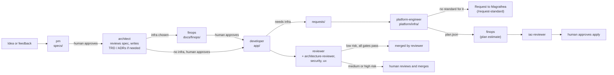

# Workflow

How work moves between personas. This file is tool-neutral; the Claude Code commands in
`.claude/commands/` follow it.

## The flow

## Handoffs are git artifacts

| From | To | Artifact |
| --- | --- | --- |
| Human | pm | A goal or feedback |
| pm | architect | `specs/<slug>.md` |
| architect | developer, platform-engineer | `docs/trd/NNNN-<slug>.md` (status `Draft` until the human approves) and `docs/adr/NNNN-<slug>.md` (status `Proposed`), or a written "No TRD needed" |
| architect | finops | `docs/adr/NNNN` or `docs/trd/NNNN` (status `Proposed` or `Draft`) that chooses infrastructure |
| finops | Human, platform-engineer | `docs/finops/NNNN-<slug>.md` |
| platform-engineer | finops | `plan.json` (and its SHA-256), before any apply |
| developer | platform-engineer | `requests/NNN-<slug>.md` |
| platform-engineer | Magrathea | `requests/magrathea-<slug>.md` for a missing standard, infrastructure type or CI/CD pattern |
| developer | reviewer | A pull request from `feat/<slug>` |
| reviewer, architecture-reviewer, iac-reviewer, security, ux | Human or merge | A written verdict with findings |

## When the architect writes a TRD

After the human approves a spec, the architect reviews it and writes a TRD when the change is
**complex**, when **no architecture exists yet** for the area, or when it needs **additional
infrastructure**. Otherwise it records why none is needed. The TRD's infrastructure table is
what the platform engineer works from, and what the architecture reviewer checks code against.

## Independent review

The persona that writes something never reviews it.

| Reviewer | Reviews | Against |
| --- | --- | --- |
| `reviewer` | Pull requests | Spec, standards, tests; sets the risk tier |
| `architecture-reviewer` | Code changes | TRD, ADRs, interfaces, spec |
| `iac-reviewer` | Infrastructure changes and plans | Standards, the request and the finops report |
| human (and `iac-reviewer`) | Finops reports | Pricing snapshots and `CONTEXT.md`; `finops` never reviews its own report |
| `security` | Sensitive changes | Security rules |
| `ux` | UI changes | `DESIGN.md` |

## Risk tiers and who merges

`.magrathea/scripts/review_risk.py` classifies each pull request as **low**, **medium** or
**high** from the files and lines changed. The reviewer may raise the tier but never lower it.

| Tier | What happens |
| --- | --- |
| low | If `auto_merge` is `low` in `magrathea.json`, CI is green, the reviewer approves and no independent reviewer has a blocker, the reviewer approves and merges. |
| medium, high | The reviewer comments with the tier, reasons and open questions, and stops. A human reviews and merges. |

Set `"auto_merge": "off"` in `magrathea.json` to make every merge a human decision. A project
may be stricter than the base, never looser. Branch protection that requires a human approval
will also stop automatic merges.

## Gates

- A human approves an ADR that chooses infrastructure together with its finops report (FIN-001),
  and applies only with a finops report for that exact plan (FIN-002). The architect never
  writes the finops report for its own ADR.
- A human approves every spec, TRD and ADR, accepts any change to a standard or policy,
  applies infrastructure, and merges anything not low risk.
- Standards and policy changes are separate PRs from the code they judge.
- A missing standard goes to Magrathea; the project does not work around the base.

## Who may edit what

| Persona | Writable paths |
| --- | --- |
| pm | `specs/` |
| architect | `docs/trd/`, `docs/adr/`, `docs/interfaces/` |
| developer | `app/`, `requests/` |
| reviewer, architecture-reviewer, iac-reviewer | nothing |
| security | `local/standards/`, `local/policy/` |
| platform-engineer | `platform/infra/`, `platform/gitops/`, `docs/runbooks/`, `docs/postmortems/`, `requests/` |
| finops | `docs/finops/**` (never the `pricing/` snapshots by convention; a human refreshes those) |
| qa-eval | `evals/`, any `evals/` folder |
| ux | nothing |

Nobody edits `.magrathea/`. It is a read-only cache of the Magrathea base, pinned by
`magrathea.lock.json`, and it changes only through `python3 scripts/magrathea_sync.py --update`.

These come from `.magrathea/agents/personas/` (the base personas, which a project cannot
change) plus anything added in `local/personas/`. In Claude Code a hook enforces the paths on
the file-editing tools. A persona that also has a shell can still write files through it, so
CODEOWNERS, branch protection and CI are the real enforcement.
