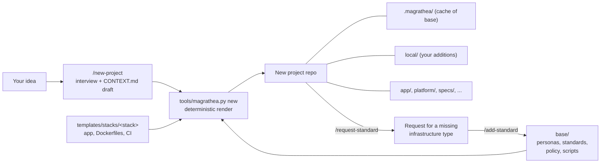

# Magrathea: Plan

Last updated 2026-10-22. Supersedes the earlier plan, which put one product and the
platform in the same repo.

## What Magrathea is

A platform engineer's tool for starting projects. You bring an idea; Magrathea scaffolds a
repository that already has AI agent personas, infrastructure standards enforced by
policy-as-code, CI and a starter app for your chosen stack. You add the project context in
`CONTEXT.md` (Magrathea helps write it); the agents do the legwork through specs, ADRs and
PRs, and humans approve each handoff.

## How it works

## Design rules

- **Deterministic output.** A script renders the project; the agent only gathers inputs.
- **Projects refer to the base, they do not copy it** (ADR 0006). A pinned commit is fetched into a
  git-ignored cache; `make upgrade` moves the pin, so new standards reach existing projects.
- **Add, never change.** `local/` can add persona behavior, standards and policy. It cannot
  reuse a base rule ID, redefine a base persona, or write policy exceptions.
- **Standards as code** (ADR 0001): a written standard, a policy that enforces it, tests.
- **Tool-neutral personas** (ADR 0004): Claude Code files are generated.
- **Two platform engineers.** The project's writes IaC from the standards and requests what is
  missing. Magrathea's maintains the standards, and is reviewed by an independent reviewer.
- **Independent review.** The author never reviews its own work: `architecture-reviewer` checks code
  against the TRD, `iac-reviewer` checks infrastructure, the `reviewer` sets a risk tier and may merge
  only low-risk changes.

## Roadmap

| Phase | Work | Gate |
| --- | --- | --- |
| 1. Scaffold (done) | Generator, base, lock check, `react-java` stack, commands | Sample project generates and verifies |
| 2. Prove it | Run `/new-project` and `/feature` in a live Claude Code session; fix what breaks. Build and run the `react-java` skeleton for real | First agent-authored PR in a generated project |
| 3. Standards | Real `tofu plan` through the Rego policies; standards for bucket, queue, cache; Kyverno tested; local dev with kind and LocalStack | Agent-written infra passes policy and plan |
| 4. Releases | Publish tagged, signed releases of the base so a project can pin and verify against them | A project cannot be pointed at an altered base unnoticed |
| 5. More stacks | Python/FastAPI, then others | A second stack scaffolds and builds |

## Open questions

- [ ] Do agents get worse as a project's specs, TRDs and ADRs grow? Measure with a synthetic large project, then accept or reject [ADR 0008](adr/0008-scaling-project-documents.md)
- [ ] Where Magrathea is published, and its license
- [ ] How projects pin and receive base versions (tags on the Magrathea repo)
- [ ] Whether the base should include an AI-eval harness persona flow for product AI features
- [ ] Which stack comes second
- [ ] Sandbox AWS account and budget alarm before the first EKS cluster
