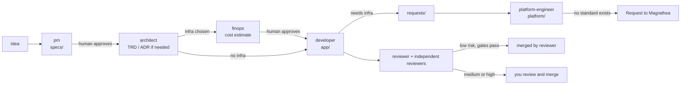

# 2. Using a project

What a developer or product owner does inside a project Magrathea created.

## What is in the folder

| Where | What | Can you change it? |
| --- | --- | --- |
| `CONTEXT.md` | What the project is | Yours to write. |
| `app/` (or the stack's equivalent) | The starter app | Yes. The `developer` persona's area. |
| `magrathea.json` | Where the base comes from, the ref to follow, `auto_merge` | Yes. |
| `magrathea.lock.json` | The exact commit fetched and a hash of every file | Only by `make upgrade`. A change shows up in review. |
| `.magrathea/` | A git-ignored cache of the base: personas, standards, policy, scripts, workflow | **No.** It is not in the repo, and CI fails if it differs from the lock. |
| `local/` | Your additions to the base | Add only; see [below](#extending-the-base-locally). |
| `specs/`, `docs/trd/`, `docs/adr/`, `docs/finops/`, `requests/`, `platform/`, `evals/` | Where each persona writes its handoff | Per persona; see [the table](#the-personas). |
| `.claude/` | Generated Claude Code agents and commands | Edit the source, then `make sync`. |

## The flow

Work moves through git artifacts. A human approves every handoff.



The full, authoritative version is `.magrathea/docs/WORKFLOW.md` in every project.

### Starting a feature

In Claude Code:

```
/feature add a login page for the web app
```

This runs spec, architecture review (a TRD only when the change is complex, has no architecture
yet, or needs more infrastructure), build, and independent review, stopping for your approval at
each handoff. You can also call a persona directly: "Use the pm agent to draft CONTEXT.md from
these notes: ...".

> Not tested: no one has yet run `/feature` end to end in a live Claude Code session. Expect to
> adjust prompts the first time. Please record what breaks.

### Commands in a project

| Command | What it does |
| --- | --- |
| `/feature <idea>` | Idea to reviewed pull request, stopping for approval at each step |
| `/review` | Independently review the current branch or PR, classify its risk, merge only if low risk and every gate passes |
| `/finops` | Estimate the monthly cost of an ADR, TRD or plan |
| `/request-standard` | Write a request to Magrathea for a missing standard, infrastructure type or CI/CD pattern |

## The personas

| Persona | Does | Writes to |
| --- | --- | --- |
| `pm` | Turns a goal into a spec | `specs/` |
| `architect` | Reviews the spec; writes a TRD and ADRs when needed; never writes feature code | `docs/trd/`, `docs/adr/`, `docs/interfaces/` |
| `developer` | Implements an approved spec; asks for infrastructure through the service YAML or a request | `app/`, `requests/` |
| `platform-engineer` | Writes infrastructure code from the standards; plans only, never applies | `platform/infra/`, `platform/gitops/`, `docs/runbooks/`, `docs/postmortems/`, `requests/` |
| `finops` | Cost estimates with dated pricing snapshots and low/expected/high ranges | `docs/finops/**` |
| `reviewer` | Reviews PRs, sets the risk tier, may merge low-risk ones | nothing |
| `architecture-reviewer` | Checks code against the TRD, ADRs, interfaces and spec | nothing |
| `iac-reviewer` | Checks infrastructure code and plans against the standards | nothing |
| `security` | Reviews sensitive changes; maintains security standards and policy | `local/standards/`, `local/policy/` |
| `qa-eval` | Writes evals and regression checks | `evals/` |
| `ux` | Reviews UI against `DESIGN.md` | nothing |

**The author never reviews its own work.** Reviewers have no write access, and a reviewer is never
the persona that wrote the change.

In Claude Code a hook enforces each persona's writable paths on the file-editing tools. A persona
that also has a shell can write files through it, so **CODEOWNERS, branch protection and CI are
the real enforcement.** Do not give agents credentials that can change cloud resources.

## Risk tiers and merging

`.magrathea/scripts/review_risk.py` classifies each pull request as **low**, **medium** or
**high** from the files and lines changed. The reviewer may raise the tier, never lower it.

| Tier | What happens |
| --- | --- |
| low | If `auto_merge` is `low` (the default), CI is green, the reviewer approves and no independent reviewer has a blocker, the reviewer merges. |
| medium, high | The reviewer comments with the tier and its reasons and stops. You review and merge. |

Set `"auto_merge": "off"` in `magrathea.json` to make every merge your decision. A project may be
stricter than the base, never looser (`make verify` and CI reject other values).

## Extending the base locally

You can add; you cannot change or remove what the base defines.

| Folder | Add | Rules |
| --- | --- | --- |
| `local/personas/` | `<name>.md` with **no** front matter appends behavior to the base persona of that name. With front matter, it defines a new persona. | A base persona's permissions and rules cannot be changed. Run `make sync` afterwards. |
| `local/standards/` | New standards in the same table format as `.magrathea/standards/README.md`. | A rule ID must not reuse a base ID. |
| `local/policy/` | Rego enforcing your standards, with tests. | `package local`; `deny` and `warn` only; no `exception` rules. |

`make verify` checks all of this and CI runs it. Change standards and policy in a PR of their own,
never in the PR that changes the thing they judge. A human approves.

## Asking for what Magrathea lacks

If the project needs infrastructure, a CI/CD pattern or a rule the base does not have (say a
message queue), do not invent a one-off. Run `/request-standard`. It writes
`requests/magrathea-<slug>.md`. Whoever maintains your Magrathea (see
[Customizing](03-customizing.md)) adds the standard, policy and tests, bumps the version, and has
it reviewed; you then run `make upgrade`.

## Make targets

| Target | What it does |
| --- | --- |
| `make setup` | Fetch the pinned base into `.magrathea/`. Run after every clone. |
| `make upgrade` | Move to the newest base for the configured ref, regenerate agents, verify. Review the diff to `magrathea.lock.json`. |
| `make verify` | Confirm the cache matches the lock and `local/` is valid. CI runs this. |
| `make sync` | Regenerate `.claude/` after editing `local/personas/`. |
| `make test` | Unit-test the Rego policies, base and local (needs `opa`). |
| `make fmt` | Format `local/policy` (needs `opa`). |
| `make check PLAN=plan.json` | Check a real plan against base and local policies (needs `conftest`); first writes `.mode.json` from `magrathea.json` for the domain checks (new projects only; an existing project copies the target by hand). Produce the plan with `tofu plan -out tfplan && tofu show -json tfplan > plan.json`. |
| `make diagrams` | Render `docs/trd/*.puml` to SVG. Skips with a message if `plantuml` is missing; `REQUIRE=1` makes that fail. |

## Upgrading

```sh
make upgrade       # or: magrathea upgrade ../my-app
git diff magrathea.lock.json
```

It prints which base files changed. Read the Magrathea [changelog](../../CHANGELOG.md): each entry
says what could break. If your `local/` additions no longer pass the new base (for example you
used a rule ID the base has since taken), `upgrade` exits non-zero and says why.

Pinning: if `ref` in `magrathea.json` is a branch, each upgrade follows it. If it is a tag, you
move only when you change the tag (`python3 scripts/magrathea_sync.py --update --ref <tag>`). The
lock records the commit, so a moved tag is detected rather than silently followed.

`make upgrade` does **not** rewrite files your project owns (README, Makefile, workflows,
`scripts/`). When the changelog says a template changed, copy the change in by hand.

## Troubleshooting

| Symptom | Fix |
| --- | --- |
| `FAIL: .magrathea/ differs from magrathea.lock.json` | Someone edited the cache, or it is stale. `make setup` restores it. Never edit it; add to `local/` or ask Magrathea. |
| `FAIL: ... redefines base rule X` | A `local/standards` file reuses a base rule ID. Rename yours. |
| `FAIL: ... must use package local` / `defines an exception rule` | Local policy may only add checks. |
| `the base fetched ... does not match magrathea.lock.json` | A tag moved or the source changed. If intended, `python3 scripts/magrathea_sync.py --update`. |
| An agent cannot edit a file | It is outside that persona's writable paths, or `make setup` has not been run. |
