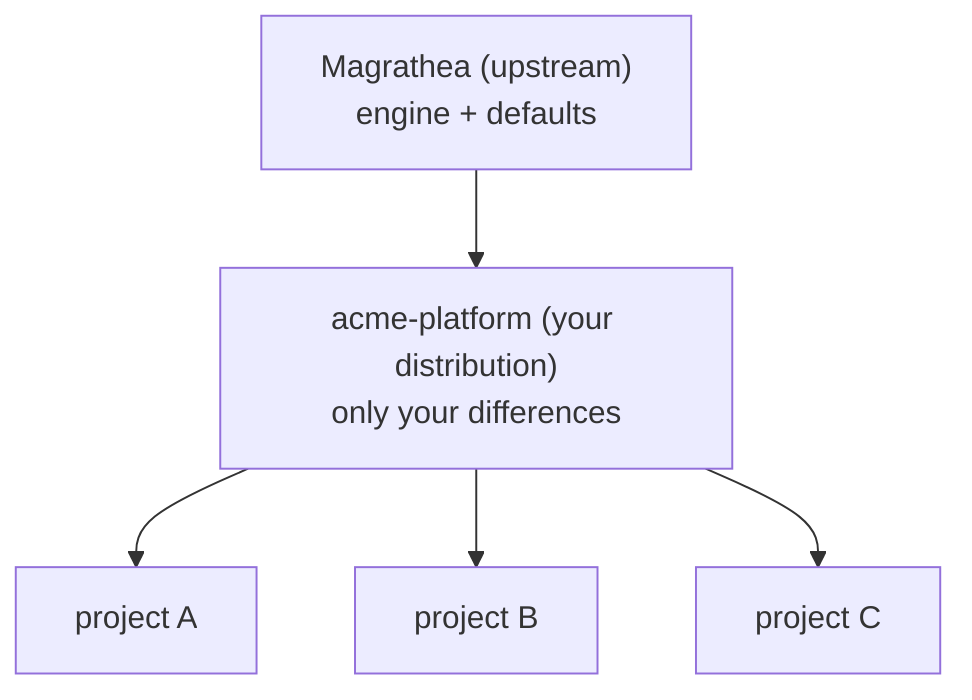
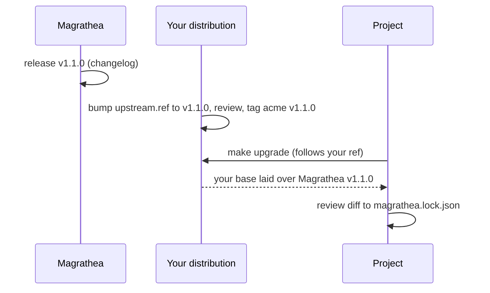

# 3. Customizing Magrathea: distributions

You are a platform engineer and want Magrathea to produce *your* company's projects: your
templates, stacks, standards, policies and personas, without forking Magrathea and fighting merge
conflicts on every upgrade.

You do this with a **distribution**: a folder (usually its own git repo) that holds **only what
differs** from Magrathea's defaults. What is left in Magrathea itself is the engine and the
workflow for creating projects and adding standards.



A working example lives in [examples/acme-platform](../../examples/acme-platform). Everything on
this page is exercised by it or by the tests.

## What a distribution can change

| You want to... | Put it in the distribution at... | Reaches |
| --- | --- | --- |
| Change the starter files every project gets (README, CODEOWNERS, CI, Makefile) | `templates/project/<same path>` | New projects, once, when created |
| Add a stack (Go API, static site...) | `templates/stacks/<name>/` with `stack.json`, `notes.md`, `files/` | New projects |
| Change one file of a default stack | `templates/stacks/<stack>/<same path>` | New projects |
| Add a company standard | `base/standards/<name>.md` | **Every project, on next `make upgrade`** |
| Add or change Rego or Kyverno policy | `base/policy/...` | Every project |
| Add a persona (e.g. compliance) | `base/agents/personas/<name>.md` | Every project |
| Change a default persona or standard | The *whole file* at the same path | Every project |
| Drop a default | `"remove": ["standards/postgres.md"]` in `distro.json` | Every project |
| Change the project workflow doc, risk tiers, slash commands | `base/docs/WORKFLOW.md`, `base/review/risk.json`, `base/claude/commands/...` | Every project |

The two halves behave differently, and it matters:

- **`templates/`** is read by the generator **at creation time** and copied into the new project,
  which then owns the files. Changing a template later does not change existing projects.
- **`base/`** is **fetched by reference** (like Magrathea's own base). Changing it reaches existing
  projects when they run `make upgrade`.

## Set one up

`magrathea init-distro` is planned but does not exist yet (see [status](#status)). By hand, it is
short.

```sh
mkdir acme-platform && cd acme-platform && git init
```

**1. `distro.json`** says what you build on:

```json
{
  "upstream": { "source": "https://github.com/<you>/magrathea.git", "ref": "v1.0.0" },
  "remove": []
}
```

- `upstream.source`: a git URL (use this for anything shared) or a folder. A relative folder is
  resolved from the distribution itself, which is how the example uses `../..`. Folders are fine
  locally and not for CI or teammates.
- `upstream.ref`: a tag or branch. **Use a tag.** This is the one place that says which
  Magrathea version you are on, so bumping it is your explicit upgrade.
- `remove`: paths under `base/` to drop from the upstream (see [layering](#how-layers-combine)).

**2. Add content.** Only what differs:

```
acme-platform/
  distro.json
  base/
    standards/acme-naming.md          # new standard
    agents/personas/compliance.md     # new persona
  templates/
    project/.github/CODEOWNERS        # replaces the default
    stacks/static-site/               # new stack
      stack.json  notes.md  files/site/index.html
```

**3. Check it.**

```sh
cd /path/to/magrathea
python3 tools/magrathea_cli.py stacks --distro ../acme-platform
python3 tools/magrathea_cli.py new ../acme-site --distro ../acme-platform \
  --name "Acme Site" --stack static-site
```

**4. Make it the default for your CLI.**

```sh
magrathea init --source /path/to/magrathea --distro /path/to/acme-platform \
  --distro-source https://github.com/acme/acme-platform.git --distro-ref v1.0.0
```

From now on `magrathea new` uses it and the new project follows
`https://github.com/acme/acme-platform.git` at `v1.0.0`. Keep your local `acme-platform` checkout at the tag you name: the templates come from the folder,
while `base/` is fetched from the URL, so a stale folder gives a project mixed content. Omit `--distro-source` and the folder's
git `origin` is used, or the folder itself if it has none (fine locally, wrong for teammates and
CI). `--distro ""` clears it.

**5. Publish.** Commit, tag (`v1.0.0`) and push. Projects fetch the tag you gave them.

## How layers combine

Resolution is two layers, upstream first. The later layer wins.

| Kind | Rule |
| --- | --- |
| Any file | A distribution file **replaces** the upstream file at the same path. Files you do not mention stay. |
| Standards | The unit of override is the **file**. To change a rule, replace its whole standards file at the same path. |
| Rule IDs | A distribution file may **not** define an ID that a different upstream file still defines. That is a hard error naming both files. (Magrathea itself repeats `COMMON-001` and `COMMON-002` across two standards; only your files are checked.) |
| Policies | New files are added; a file at the same path replaces the default. |
| Removing | Explicit, in `remove`, by path under `base/`. A path that matches nothing is an error, so a stale entry after an upstream rename is noticed. |
| Version | `base/VERSION` and `CHANGELOG.md` belong to you. If you ship no `base/VERSION`, the project records the upstream's. |
| Chaining | An upstream may not itself be a distribution. |

**Replacing a whole file has a cost.** If you copy Magrathea's `postgres.md` to tweak one value,
you stop receiving upstream improvements to that file. Prefer *adding* a standard, or a `local`
rule in the project, when you can. When you do replace, diff against the upstream file each time
you bump `upstream.ref`.

Projects still cannot weaken anything you ship. `make verify` in a project rejects a `local/`
standard that reuses an ID from the merged base (yours or upstream's) and any local policy
exception, exactly as before.

## Pinning and upgrading

A project follows your distribution. Its `magrathea.lock.json` records your commit **and** the
upstream commit, plus one hash of the merged result. So:

- A fresh clone (`make setup`) reproduces exactly what was reviewed, even if an upstream tag later
  moves.
- A new Magrathea release does **not** reach any project until you bump `upstream.ref`, commit and
  tag your distribution, and the project runs `make upgrade`. You review the upstream change once,
  and projects receive it deliberately.



Tested: both commits are pinned; an upstream change is invisible until the distribution bumps its
ref; a moved upstream tag does not change what a locked project receives; editing the cache is
caught.

## Making changes to a distribution safely

Every change to your `base/` reaches every project, so treat it as a release:

1. Change it on a branch; get a second person (or the reviewer persona) to review.
2. Bump your `base/VERSION` and add a `CHANGELOG.md` entry that says *what could break*.
3. Never weaken or remove a rule without a human decision. Magrathea has
   `python3 tools/check_base_change.py --base <branch>` for this, but it compares Magrathea's own
   `base/` and does **not** yet understand a distribution; review diffs by hand until it does.
4. Tag. Projects pick it up on `make upgrade`.

A rule is `implemented` only with a passing and a failing test. Write `planned` for a rule that has
no policy yet, and say what enforces it (reviewer judgment is allowed and honest).

## Authoring reference

### A standard

A Markdown file with a rule table. See `.magrathea/standards/README.md` in any project.

| ID | Strength | Rule | Enforced by | Status |
| --- | --- | --- | --- | --- |
| ACME-001 | MUST | Resource names start with `acme-` | reviewer judgment | planned |

IDs are stable and never reused. MUST blocks; SHOULD warns.

### A persona

Markdown with front matter, then the prompt body.

```markdown
---
name: compliance
description: One sentence that says when to use it.
access: read            # read | read-shell | edit-no-shell | edit-shell
writable_paths:         # only for edit-* access
  - docs/compliance/
---
# Compliance
## Role ...  ## Read first ...  ## Check ...  ## Report ...  ## Never ...
```

The name must match the file name. A read-only persona cannot have writable paths; an editing
persona must have some; a persona may never write to `.magrathea/`. `make sync` (or project
creation) generates `.claude/agents/<name>.md`.

### A stack

```
templates/stacks/<name>/
  stack.json      {"name", "title", "summary", "tested"}  (tested: say honestly what was built)
  notes.md        goes into the project's AGENTS.md under "Stack"
  files/          copied to the project root
```

Templates use `@@placeholder@@`: `name`, `slug`, `description`, `stack`, `stack_title`,
`stack_notes`, `magrathea_version`, `owner`, `source`, `ref`. An unknown placeholder fails the
build. A stack file may not collide with a project template file.

## Adding standards and stacks with the personas

Magrathea ships `/add-standard` and `/add-stack`, driven by the `magrathea-platform-engineer`
persona, and `magrathea-reviewer` reviews the result. **They currently edit Magrathea's own
tree** (`base/`, `templates/`), not a distribution. They are not distribution-aware yet, so
for a distribution write the files yourself using the reference above. The personas are still
useful to draft content, as long as you copy it into your distribution and run its tests.

## Status

What exists, tested:

- `--distro` for the generator and CLI: template and stack layering.
- A distribution's `base/` laid over its upstream by `scripts/magrathea_sync.py`, with `remove`,
  rule-ID checks, pinning of both commits, and the lock check on the merged tree.
- The example distribution, built by `make test` and `make sample`.
- Version fields: engine `VERSION`, `ENGINE_CHANGELOG.md`, `version:` in the front matter of each
  Magrathea workflow persona and command.

Decided but **not built yet** (ADR 0007):

- `magrathea init-distro` to create the skeleton.
- Choosing, per workflow persona or command, whether to follow the engine, pin an older release,
  or keep a local copy (`workflow.ref`, `pin`, `local` in `distro.json`), with
  `magrathea workflow status` and `update`.
- `meta/compatibility.json` and the generated `docs/COMPATIBILITY.md`, recording which engine
  versions each workflow persona version works with.
- Distribution-aware `/add-standard`, `/add-stack` and `check_base_change.py`.
- Checking the engine checkout against the version a distribution expects. The rule, already
  decided: the checkout you run is authoritative, and a mismatch stops with an instruction rather
  than silently continuing.

Until then: the version you run is simply the Magrathea checkout you have. Pin it yourself with a
git tag.

Details and reasons: [ADR 0007](../adr/0007-engine-and-distributions.md).
