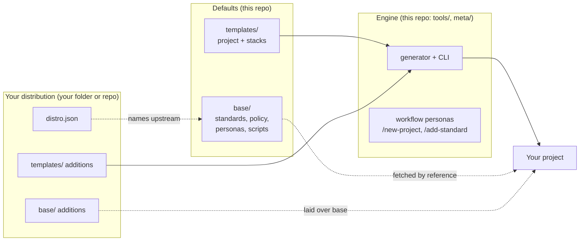

# Magrathea guide

Magrathea scaffolds software projects that come with AI agent personas, written infrastructure
standards enforced by policy-as-code, CI and a starter app. This guide is for the **human**:
the platform engineer who sets Magrathea up for a team, and the developer who then builds with
it.

| If you want to... | Read |
| --- | --- |
| Understand the pieces in five minutes | [Concepts](#concepts) below |
| Create your first project | [1. Getting started](01-getting-started.md) |
| Work day to day inside a project | [2. Using a project](02-using-a-project.md) |
| Make Magrathea yours: your templates, stacks, standards, personas | [3. Customizing: distributions](03-customizing.md) |
| See complete worked examples | [4. Sample projects](04-sample-projects.md) |
| Look up a file format, flag or make target | [5. Reference](05-reference.md) |
| Share one cluster and network between several projects | [7. Domain platforms](07-domain-platform.md) |
| Find a quick answer | [6. FAQ](06-faq.md) |

## Concepts

**Engine.** The tools that create and upgrade projects (`tools/`), and the Magrathea-side
workflow: the `/new-project`, `/add-standard` and `/add-stack` commands and the personas behind
them (`meta/`). It has its own version: [VERSION](../../VERSION) and the
[engine changelog](../../ENGINE_CHANGELOG.md).

**Defaults.** An opinionated starting set of content: standards (EKS, Postgres, FinOps, local
setup, AWS architecture, domain platform), Rego and Kyverno policies, eleven project personas, a project template
and three stacks (two applications and the `domain-platform` skeleton). Versioned by [base/VERSION](../../base/VERSION) and the
[changelog](../../CHANGELOG.md).

**Distribution.** A folder of your own that holds only what differs from the defaults: your
templates, stacks, standards and personas. Projects follow your distribution; it names the
upstream (Magrathea) it builds on. This is how a company makes Magrathea its own without
forking it. See [Customizing](03-customizing.md).

**Project.** What `magrathea new` creates. It does not contain the base. It *refers* to it
(`magrathea.json`), pins the exact commit (`magrathea.lock.json`) and caches it in a git-ignored
`.magrathea/`. A standard added upstream reaches an existing project on `make upgrade`.

**Personas.** Tool-neutral Markdown files describing a role (PM, architect, developer,
reviewer...). For Claude Code they are generated into `.claude/agents/`. Humans approve every
handoff; the one exception is that the reviewer may merge a pull request classified low risk
when every gate passes (and you can turn that off).

## What is and is not proven

Read this before relying on it. The generator, the lock and sync logic, the path guard, the risk
classifier, distribution layering and the Rego policies are covered by tests (`make test`).
**Not tested:** the stacks' Maven and npm builds (React/Java), the `domain-platform` OpenTofu (never run or validated), the Kyverno policies, the CI
workflows, fetching from a private GitHub repo, the policies against a real `tofu plan`, and
anything inside a live Claude Code session. Whether the personas follow their instructions has
not been evaluated. Each stack's own notes say what was and was not built.
