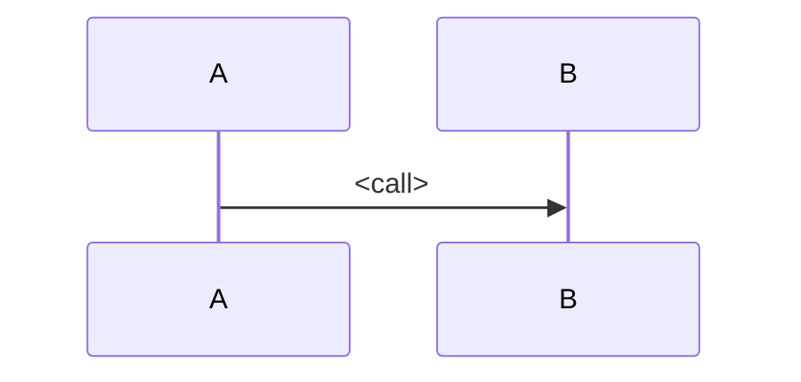

# TRD NNNN: <title>

Status: Draft | Approved (only a human sets Approved) | Superseded by TRD NNNN
Spec: `specs/<slug>.md`
Author: architect
Date: <date>

## Summary

<what is being built, in three sentences, and why a TRD is needed: complex / no architecture
yet / new infrastructure>

## Requirements this design must satisfy

<restate the spec's acceptance criteria that drive design choices; link, do not copy>

## Design

### Components and responsibilities

| Component | Responsibility | Owns data | Talks to |
| --- | --- | --- | --- |

### Interfaces

<public APIs, events and contracts, with request/response shapes. Link `docs/interfaces/`.>

### Data model

<entities, key fields, constraints, retention. Migration approach if the model changes.>

### Flows

## Infrastructure needs

Every need is a line here. The platform engineer works from this table.

| Need | Standard rules that cover it | Status |
| --- | --- | --- |
| e.g. Postgres database | PG-001 to PG-009 | covered |
| e.g. message queue | none | **needs a Magrathea request** |

## Deployment architecture

<`n/a` unless the project's cloud has an architecture standard (today: AWS, see
`.magrathea/standards/aws-architecture.md`). If it applies: diagram source is
`docs/trd/NNNN-<slug>.puml` (PlantUML text; render with `make diagrams`, do not commit the
output). Every element is labeled with its covering rule ID; elements with no standard are dashed
and labeled `needs a Magrathea request`. Keep this consistent with the Infrastructure needs table.>

Diagram: `docs/trd/NNNN-<slug>.puml`

## Security and privacy

<data classification, authentication and authorization, secrets, personal data handling>

## Testing and evals

<unit/integration strategy, what the architecture reviewer and QA should check, AI evals if
the feature uses a model>

## Rollout and migration

<order of changes, feature flags, rollback>

## Risks and open questions

- <risk or question, who answers it>

## Alternatives considered

| Option | Why not |
| --- | --- |

## Decisions that need an ADR

- <hard-to-reverse choice> (ADR to be written)
